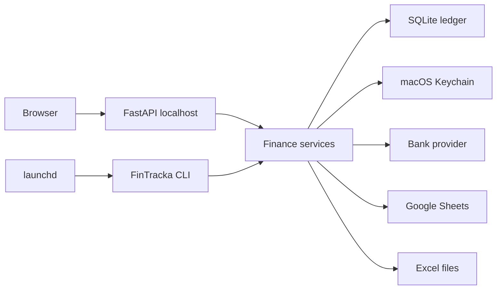

# FinTracka Architecture

## Components



- `fintracka serve` binds to `127.0.0.1` and serves the API plus the built React application.
- CLI and API call the same service layer; neither owns financial logic.
- SQLite uses WAL, foreign keys, a busy timeout, and explicit transactions.
- A macOS `fcntl` lock serializes sync, import, export, backup, and restore writes across CLI and server processes.
- A single in-process executor handles user-started jobs. Persisted job rows make interruption observable and retryable.

## Backend boundaries

- `fintracka/db`: connection policy, migrations, repositories, and transaction boundaries.
- `fintracka/domain`: money, IDs, provider-neutral DTOs, categorization, transfers, reconciliation, budgets, and reports.
- `fintracka/services`: orchestration for sync, CSV import, exports, backups, and jobs.
- `fintracka/providers`: synthetic and Plaid adapters; later providers implement the same protocol.
- `fintracka/api`: Pydantic schemas, session security, and HTTP routes.
- `fintracka/cli.py`: command dispatch only.

## Provider contract

```python
class BankProvider(Protocol):
    def create_link_session(self) -> LinkSession: ...
    def complete_link(self, payload: Mapping[str, object]) -> ConnectedItem: ...
    def repair_connection(self, connection_id: str) -> LinkSession: ...
    def fetch_updates(self, connection: ProviderConnection, checkpoint: str | None) -> SyncBatch: ...
    def revoke(self, connection: ProviderConnection) -> None: ...
```

Provider payloads are normalized before leaving the adapter. Secrets are represented by Keychain references, never plaintext values.

## Sync transaction

1. Acquire the global lock and create a sync-run row.
2. Fetch all pages from the saved checkpoint into a validated in-memory batch.
3. Restart Plaid pagination from the original cursor when mutation-during-pagination is reported.
4. In one SQLite transaction, upsert accounts/balances, resolve external aliases, apply additions/modifications/tombstones, run eligible rules, record audit events, and commit the checkpoint.
5. Record sanitized counts and status. Retry transient failures at most five times with jitter; auth/consent errors require repair.

## HTTP API

All routes use `/api/v1`. Major resources are session/system, overview/reports, providers/connections, accounts/balances, transactions/splits/transfers, categories/rules, tracking/envelope budgets, sync/import/reconciliation/export/backup jobs.

List endpoints have stable sort order, cursor pagination, explicit filters, and response models. Mutations require a local session, CSRF token, strict Host/Origin validation, and `updated_at` conflict detection.

## Frontend

React Router provides persistent left navigation. TanStack Table powers the transaction register. One chart library renders reports. The frontend stores only presentation preferences; it never stores provider or Google tokens.

## Deployment

Release use is one local Python process. No Docker, reverse proxy, public listener, cloud database, Redis, queue, or webhook receiver is introduced.

