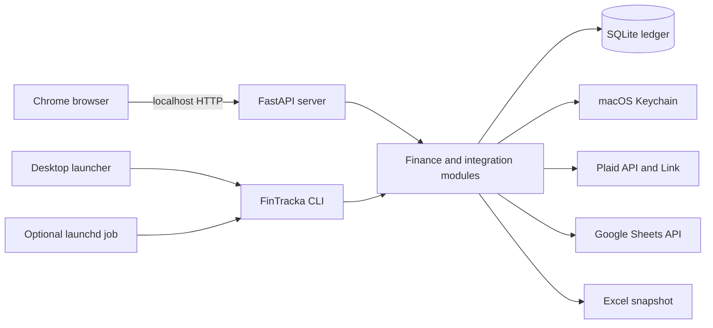

# FinTracka: Complete Application and Research Handoff

- **Snapshot date:** 2026-10-27
- **Repository:** `/Users/david/Cursor Project/FinTracka`
- **Current local branch:** `main`
- **Application baseline examined:** `6833e92` (`Count transfers into savings in planning`)
- **Database schema:** migration 17
**Audience:** an engineering or research agent that needs to understand the current application before proposing, evaluating, or implementing changes.

This document describes the application that is actually implemented. Older specifications under `docs/superpowers/` explain how features were designed, but some details were superseded later. When this document and an older design disagree, verify the current source and migrations; do not assume the older design still controls behavior.

## 1. Executive summary

FinTracka is a local-first, single-household personal finance application for macOS. It imports real account and transaction data through Plaid, stores the authoritative ledger in a local SQLite database, and serves a React interface from a FastAPI process bound only to localhost.

The product is designed for David and Ariela. Accounts and transactions may be assigned to `David`, `Ariela`, or `Shared`, but this is reporting ownership rather than separate authentication. There is one household ledger and one local browser session model.

The application currently provides:

- Plaid connections using separate David and Ariela credential profiles.
- Account balances, transaction history, categorization, subcategorization, search, filtering, splits, archive, manual cash entries, and transfer review.
- Planning with recurring income, monthly spending targets, historical averages, actual spending, remaining amounts, trends, and a 10% Salary-based Tzedaka minimum.
- Overview and Reports, including an interactive Sankey-style cash-flow chart and David/Ariela/Shared spending splits.
- Savings and Retirement tracking with connected balances, manual assets, virtual goals, monthly goals, optional overall goals, allocation rules, overflow rules, monthly reviews, and an append-only goal ledger.
- CSV history import, Excel export, Google Sheets export, verified local backups, and optional scheduled sync.
- Strict localhost session, CSRF, Host, Origin, CSP, Keychain, audit, and optimistic-concurrency protections.

SQLite is the financial source of truth. Plaid and Google are integrations, not authoritative stores. Spreadsheet edits are never imported back into the ledger.

## 2. Product boundaries

### Current scope

- One Mac.
- One household ledger.
- Two reporting people plus Shared ownership.
- USD combined reporting.
- Plaid Transactions only.
- Local SQLite persistence.
- Local browser UI, normally opened in Google Chrome.
- One-way Excel and Google Sheets exports.
- Manually valued savings, investments, and other assets.

### Explicit non-goals or currently unsupported areas

- No public hosting or remote access.
- No mobile application.
- No multi-user login or permission system.
- No bank credentials handled by FinTracka; credentials are entered in Plaid Link.
- No Plaid Auth, Identity, routing/account numbers, Payments, Transfer, or Investments products.
- No investment holdings, securities, cost basis, performance, trading, or market-price service.
- No automatic foreign-exchange conversion; combined financial reporting is USD-only.
- No AI/cloud transaction categorization.
- No SimpleFIN or Teller integration.
- No Pershing-specific implementation. Pershing should remain unassigned until it can be connected and reviewed through a supported path.
- No guaranteed off-device backup yet. Local verified backups exist, but total disk loss remains an accepted risk.

## 3. System architecture



### Runtime components

- **Backend:** Python 3.14, FastAPI, standard-library SQLite.
- **Frontend:** React 19, TypeScript 7, Vite 8, React Router, Recharts, TanStack Table, Lucide icons, and `react-plaid-link`.
- **Database:** SQLite in WAL mode with foreign keys, `busy_timeout=5000`, and synchronous `NORMAL`.
- **Secrets:** macOS Keychain through `keyring`; SQLite stores reference names only.
- **Background jobs:** one in-process job runner with persisted job rows.
- **Process serialization:** a macOS `fcntl` process lock protects sync and other multi-process operations.
- **Deployment:** one local Python server process. There is no Docker, reverse proxy, Redis, cloud database, or external queue.

### Main source modules

- `src/fintracka/api.py`: FastAPI models, security middleware, HTTP routes, job submission, and static frontend serving.
- `src/fintracka/cli.py`: serve, configure, sync, export, backup, restore, and schedule commands.
- `src/fintracka/db.py`: SQLite connection policy and numbered migrations.
- `src/fintracka/sync.py`: provider-neutral account/balance/transaction upserts and checkpoint commits.
- `src/fintracka/plaid_adapter.py`: Plaid SDK boundary, Link, transaction sync pagination, normalization, retry, repair, and revoke.
- `src/fintracka/plaid_service.py`: credential profiles and persisted Plaid connection orchestration.
- `src/fintracka/ledger.py`: user edits, categorization rules, splits, transfer matching, payment archiving, and reconciliation.
- `src/fintracka/subcategories.py`: subcategory matching, learning, reprocessing, and undo.
- `src/fintracka/reports.py`: ledger rows, overview, cash flow, category totals, ownership totals, and Sankey inputs.
- `src/fintracka/planning.py`: planned income, targets, averages, Tzedaka floor, trends, and planning status.
- `src/fintracka/budgets.py`: older Tracking and Envelope Budget calculations.
- `src/fintracka/savings.py`: connected savings accounts, manual assets, activity, and balance history.
- `src/fintracka/savings_goals.py`: virtual savings-goal ledger, allocation, overall goals, overflow, draws, reviews, reconciliation, and undo.
- `src/fintracka/manual_cash.py`: app-owned manual expense lifecycle.
- `src/fintracka/imports.py`: CSV preview, validation, duplicate handling, and commit.
- `src/fintracka/exports.py`: deterministic Excel/Google snapshot model.
- `src/fintracka/google_sheets.py`: Google OAuth and workbook gateway.
- `src/fintracka/backups.py`: online SQLite backup, integrity verification, retention, and restore.
- `src/fintracka/jobs.py`: persisted background jobs and interrupted-job recovery.
- `src/fintracka/security.py`: one-use bootstrap sessions and local Host/Origin validation.
- `src/fintracka/readiness.py`: FileVault, Keychain, credential, backup, and scheduler readiness checks.
- `src/fintracka/launchd.py`: optional login and 06:17 local scheduled sync.

## 4. Installation, launch, and persistence

### Runtime requirements

- macOS.
- Python `>=3.14,<3.15`.
- Node 24 or newer.
- The Python dependencies in `requirements-dev.txt`.
- Frontend dependencies pinned in `frontend/package-lock.json`.

### Important paths

- Repository: `/Users/david/Cursor Project/FinTracka`
- Desktop launcher: `/Users/david/Desktop/FinTracka.command`
- Repository launcher: `scripts/launch_fintracka.command`
- Live database: `~/Library/Application Support/FinTracka/fintracka.sqlite3`
- Backups: `~/Library/Application Support/FinTracka/backups/`
- Process lock: `~/Library/Application Support/FinTracka/fintracka.lock`
- Scheduled-sync logs: `~/Library/Application Support/FinTracka/logs/`
- LaunchAgent: `~/Library/LaunchAgents/com.fintracka.sync.plist`
- Built frontend: `frontend/dist/`

### Desktop launcher behavior

Double-clicking the Desktop launcher runs the repository launcher. It:

1. Detects an existing server on port 8787.
2. If one is running, attempts a Plaid sync, then stops the old process.
3. Runs the latest frontend production build.
4. Starts `python -m fintracka.cli serve --open-chrome`.
5. Opens a fresh one-use bootstrap URL in Google Chrome.

The Terminal window must remain open. `Control-C` stops the server. Reusing an old bootstrap URL may show a locked page because each bootstrap token is single-use and stored only in server memory.

### Persistence model

- Closing Chrome does not delete data.
- Stopping the local server does not delete data.
- Categories, notes, splits, account settings, goals, and audit history persist in SQLite.
- The browser stores only presentation preferences:
  - `fintracka-theme`
  - the last transaction categorization scope
  - `fintracka.savings.ownerSplit`
- Provider and Google tokens are never stored in browser storage.

## 5. Authentication and HTTP security

The application has local session protection even though it is not publicly hosted.

1. The server generates a random bootstrap token at startup.
2. Chrome opens `http://127.0.0.1:8787/#bootstrap=...`.
3. The frontend exchanges that token once through `POST /api/v1/session/bootstrap`.
4. The backend issues an HttpOnly, SameSite-Strict `fintracka_session` cookie.
5. The frontend fetches a separate CSRF token and sends it on every mutation.

Additional controls:

- Server binds to `127.0.0.1` by default.
- Only localhost/test Host headers are accepted.
- Mutation Origins must be local HTTP origins.
- Request models reject unexpected fields.
- CSP permits only the selected Plaid environment API, FinTracka assets, and Plaid's required Link CDN/frame.
- Responses set `X-Content-Type-Options`, `X-Frame-Options`, `Permissions-Policy`, `Referrer-Policy`, and `Cache-Control: no-store`.
- OpenAPI, Swagger, and Redoc are disabled.
- Secrets and raw provider payloads are not returned by the API.
- Mutable records use `updated_at` optimistic conflict checks where appropriate.

Sessions are held in server memory. Restarting the server invalidates existing browser sessions and requires a new launcher URL.

## 6. Data and money conventions

- IDs are sortable UUIDv7 text.
- Money is stored as signed integer minor units; USD dollars are never stored as floating-point values.
- A positive transaction amount means money entering an account.
- A negative transaction amount means money leaving an account.
- Currencies use uppercase three-letter codes.
- Dates use `YYYY-MM-DD`; months use `YYYY-MM`; instants are UTC RFC 3339 strings.
- Reporting dates use `America/New_York` conventions.
- Combined financial reports exclude non-USD transactions rather than inventing exchange rates.
- Provider facts and user edits are separate fields so a resync does not erase user categorization, notes, ownership, or splits.

## 7. Plaid integration

### Products and history

FinTracka requests only Plaid Transactions. Link creation requests up to 730 days of history for a new Item, subject to the institution and Plaid account actually providing it. Once Transactions has initialized on an Item, reconnecting does not expand its history window and may consume another Trial Item. Older history should be added with CSV History Import instead.

### Two credential profiles

The same household ledger can use two independently configured Plaid developer profiles:

- `david`
- `ariela`

Each provider connection permanently records the profile and environment that created it. Sync, repair, and revoke must use that exact profile; credentials must never silently fall back to the other profile.

The Plaid profile does **not** determine spending ownership. Account and transaction ownership remains an editable David/Ariela/Shared reporting property.

A second developer team does not guarantee a separate Trial allowance, institution approval, or violation-free way around Plaid limits. Research must verify Plaid's current terms before relying on multiple developer accounts.

### Credential storage

The supported configuration commands are:

```sh
.venv/bin/python -m fintracka.cli configure plaid \
  --profile david \
  --environment production \
  --client-id CLIENT_ID \
  --secret-stdin

.venv/bin/python -m fintracka.cli configure plaid \
  --profile ariela \
  --environment production \
  --client-id CLIENT_ID \
  --secret-stdin
```

Secrets are stored under Keychain service `com.fintracka.provider` using generated reference names. SQLite stores those reference names and profile metadata, never the secret value. Do not print, inspect, migrate, or rewrite live Keychain values during ordinary research.

### Link completion safety

When a public token is exchanged:

1. Plaid creates the Item/access token.
2. The access token is written to Keychain.
3. Sanitized institution and connection metadata plus the Keychain reference are written to SQLite in one transaction.
4. If local persistence fails, FinTracka attempts to revoke the new Plaid Item and remove partial local secret state.

### Sync behavior

- Each active connection has a saved Plaid cursor.
- All pages are collected and normalized before the ledger/checkpoint transaction commits.
- Mutation-during-pagination restarts from the original cursor.
- Added, modified, and removed transactions are handled idempotently.
- Pending-to-posted aliases converge on one canonical transaction without losing user edits.
- A failed sync does not advance the checkpoint.
- Transient Plaid errors retry with bounded jitter; consent/authentication errors move the connection to Repair.
- Sync tries all active connections even if an earlier connection fails.
- Error records are sanitized codes, not raw provider exceptions.

### Startup sync

Starting the FastAPI app queues a sync whenever an active Plaid connection exists and no sync job is already queued/running. The Desktop launcher also attempts a CLI sync before restarting an already running server.

### Current operational concern

At the latest local launch, the automatic Plaid refresh failed for all active connections and the app opened using locally stored data. The failure is intentionally non-destructive, but it means freshness must be diagnosed before assuming that recent bank activity is present. Start with connection status/error codes and Keychain/profile configuration; do not disconnect/reconnect Items as a first troubleshooting step.

## 8. Provider-neutral sync and ledger guarantees

`apply_batch` is the provider-neutral boundary. A normalized batch may include accounts, balances, added transactions, modified transactions, removed transactions, and a next checkpoint.

The batch transaction:

1. Upserts accounts.
2. Stores balance observations.
3. Upserts canonical transactions and external-ID aliases.
4. Preserves user-owned edits.
5. Handles pending-to-posted identity.
6. Tombstones provider removals rather than deleting history.
7. Applies provider mapping, automatic rules, subcategories, transfer/payment logic, and savings reconciliation.
8. Writes audit events.
9. Commits the checkpoint only with the complete ledger mutation.

Failures roll back both financial rows and the cursor.

## 9. Accounts

Each account contains provider identity, account type/subtype/nature, currency, status, reporting flags, spending owner, and optional savings-pool assignment.

Editable behavior:

- Nickname.
- Spending owner: David, Ariela, or Shared.
- Include in Overview.
- Include in Budget/Planning.
- Include in Net position.
- Include in Exports.
- Include in Savings.
- Savings pool: Regular Savings, Retirement, or neither.

Removing an account is reversible. The account is marked hidden and disappears from ordinary reports, planning, exports, savings, and transaction views while its local history remains stored. `Show removed accounts` allows restoration.

This is the correct solution for duplicated joint accounts connected through both spouses' logins. It does not revoke the entire institution connection.

## 10. Transactions

### Canonical record

A transaction retains:

- provider account and external identity;
- local date and optional UTC instant;
- signed minor-unit amount and currency;
- provider description and merchant;
- provider category metadata;
- pending and tombstone states;
- user merchant, category, subcategory, notes, and spending owner;
- cash-withdrawal marker;
- manual archive marker;
- split state;
- created/updated timestamps.

The detail endpoint exposes account and provider-safe transaction metadata so a user can inspect what account a row came from without exposing secrets.

### Search and filters

The Transactions page supports merchant/description search, category, subcategory, account, ownership, transfer visibility, archive visibility, and cursor pagination. The control area wraps on smaller screens.

### Archive

Archiving removes a transaction from ordinary transactions, planning, reports, exports, and savings calculations while retaining it locally. It is intended for reversals, erroneous provider rows, or other entries the user explicitly does not want included. Archive is reversible.

### Manual cash

Manual cash entries use an internal app-owned account. A manual entry requires a title, positive user-entered amount, and expense category; date defaults to today and owner defaults to Shared. The ledger stores the expense as a negative amount.

Manual cash participates in transaction search, categories, planning, reports, ownership totals, and exports. It does not affect observed bank balances or net position. A manual cash row may be edited or soft-deleted; provider-owned transactions cannot be deleted through this operation.

### Splits

Transaction splits must sum exactly to the parent amount. Reporting excludes the parent and uses the children, preventing double counting. Category changes and savings reconciliation account for split mutations.

## 11. Categories and automatic learning

### Main groups and built-in categories

- **Income:** Salary, Other income.
- **Essentials:** Housing, Groceries, Transport, Utilities, Insurance, Healthcare.
- **Lifestyle:** Dining, Shopping, Fun, Travel.
- **Tzedaka:** Tzedaka is its own group and category.
- **Financial:** Fees & interest, Taxes, Refunds & reimbursements, Savings, Transfer, Credit card payment, Debt payments, Other.

Users can create additional category groups/categories through the API/UI where exposed. Transfer and Credit card payment use excluded reporting behavior. Refunds & reimbursements offset spending rather than inflate income.

### Category sources and precedence

Category assignments retain their origin, such as provider, rule, or manual. A manual choice is protected from provider resync and automatic rule replacement.

Automatic rules are ordered by priority and first match wins. Supported rule conditions are validated at the API boundary. Rules can be previewed and reprocessed.

### Three correction scopes

The compact scope control is remembered in browser local storage:

- `1×`: this transaction only.
- `→`: this and future matching transactions.
- `↔`: eligible past and future matching transactions.

The matching rule is derived from normalized merchant/provider facts. Each correction returns an undo ID when an undoable batch was created.

Imported cash withdrawals are special: every withdrawal is unique, defaults to Other/Cash withdrawal, and category edits are always one-time. They never create a rule affecting other withdrawals.

### Subcategories

Subcategories belong to exactly one parent category. Database triggers reject an incompatible parent/child combination.

Built-in examples include:

- Shopping: Clothing, Home improvement, Household, Electronics, Gifts, Online shopping, Personal items, General.
- Transport: Fuel, Auto repairs, Parking, Tolls, Public transit, Rideshare, Registration, General.
- Dining: Restaurants, Takeout & delivery, Coffee & bakeries, Bars, General.
- Tzedaka: Synagogue & community, Torah & education, Direct assistance, Organizations, Other.
- Other categories include detailed Housing, Groceries, Utilities, Insurance, Taxes, Travel, Healthcare, Fees, Debt, Fun, and Other subcategories.

Built-in merchant and Plaid-detail rules cover common merchants such as Lowe's/Home Depot, Macy's, Amazon, supermarkets, warehouse clubs, pharmacies, streaming services, rideshare, fuel, airlines, hotels, theaters, coffee, and delivery services. User-learned rules outrank built-in fallbacks. Users can also create a custom subcategory.

## 12. Transfers, Zelle, credit-card payments, and Savings transfers

### Candidate rules

A possible internal transfer requires:

- different owned accounts;
- the same currency;
- exact opposite amounts;
- posting dates no more than three days apart;
- neither transaction already belonging to another confirmed pair.

Candidates within one day are high confidence; two or three days are medium confidence. The user may inspect both transaction details, confirm with the check control, or reject with the X control.

### Learned transfer behavior

After a user confirms a pair, FinTracka learns the specific source account, destination account, and normalized outgoing/incoming counterparty pattern. Future or historical candidates are auto-confirmed only when that full pattern repeats. Same-amount transfers involving unrelated people/accounts do not automatically inherit the rule.

Rejected pairs remain visible and are not repeatedly suggested as the same pair.

### Credit-card payments

Credit-card payments are not spending because the underlying card purchases are already represented. FinTracka conservatively detects provider payment categories, credit-account positive payments, exact account-side pairs, and payment descriptions. Detected card payments are automatically categorized as Credit card payment and archived from ordinary financial views.

### Latest Savings-transfer rule

An exact confirmed transfer from a **non-savings** source account into an account assigned to either the Regular Savings or Retirement pool is treated specially:

- The outgoing side is categorized as **Savings**.
- It appears once in Planning, Overview, and Reports as a Savings outflow.
- The incoming side does not become income.
- Historical confirmed matches are backfilled unless the outgoing transaction has a protected manual category.
- Transfers between two tracked savings accounts remain hidden, because they do not create new household saving.
- The user may manually recategorize the outgoing side; a manual choice remains protected.

This behavior was added in migration 17 and supersedes older design text that said every savings transfer should remain outside Planning.

## 13. Overview and Reports

### Overview

Overview uses the latest included USD balance for each account and shows:

- cash/assets;
- card liabilities;
- net position;
- monthly income/spending/net movement;
- observed cash movement when opening balance history exists;
- recent activity.

Manual cash is reported separately from observed bank-balance movement because there is no reliable physical-cash balance.

### Reports

Reports provides:

- monthly Income, Spending, and Net metrics;
- spending by category;
- spending by David, Ariela, and Shared;
- a clickable Sankey-style Income → group → category flow;
- category/flow drawers with contributing transactions;
- inline recategorization using the same `1×`, `→`, and `↔` scopes.

When person splitting is enabled:

- David is blue.
- Ariela is pink.
- Shared is dark purple.
- Final category nodes show their share of total spending and each person's share where applicable.

Flow layout keeps child categories adjacent to their parent groups and uses spacing/minimum geometry to reduce overlap. Exact numbers and labels accompany color so the chart is not color-only.

### Reporting exclusions

Ordinary report rows exclude:

- tombstoned transactions;
- manually archived transactions;
- pending transactions;
- hidden accounts;
- non-USD rows from USD totals;
- confirmed ordinary internal transfers;
- credit-card payments.

The Savings-transfer exception described above intentionally includes the outgoing side once.

## 14. Planning

Planning is a forward-looking household plan built on real ledger activity. Planned income never creates a bank transaction or changes account balances.

### Planned income

Each source has a title, type (`Salary` or `Custom`), amount, effective month, and active state. Recurring edits create an effective version from the selected month forward. A one-month override affects only one month. Deactivation preserves history.

### Tzedaka minimum

For each month:

```text
minimum Tzedaka = ceil(total planned Salary / 10)
```

Custom income does not affect the minimum. The effective Tzedaka target is the larger of the user target and the calculated 10% minimum. Actual bank and manual-cash Tzedaka transactions count toward it.

### Spending targets

Each expense category can have:

- a recurring effective-dated target beginning in a chosen month;
- an optional one-month override.

Historical months retain their prior target versions. Targets are household targets even when actual activity is filtered to one person.

### Historical averages

The window is 1–12 completed months preceding the selected month.

- Unavailable leading months are excluded from the denominator.
- An observed zero-spending month inside available history is included as zero.
- The partial selected month is never included in its own historical average.
- Refunds reduce spending.
- Manual cash counts.
- Transfers, card payments, pending/tombstoned/archived entries, excluded accounts, and non-USD rows do not count, except the explicit Savings outflow rule.

The response exposes requested window size, actual usable months, earliest usable month, trend points, current actuals, targets, remaining amounts, percentages, and contributing transaction IDs.

### Planning interface

- Month selector.
- Everyone/David/Ariela/Shared actual-spending filter.
- Average-window slider.
- Planned income editor.
- Summary of target total, actual spending, remaining amount, and income after targets.
- Category flow lanes sized approximately to target/use while retaining a usable minimum.
- Historical average, target, actual, remaining, and status indicators.
- Hidden-category control for categories with neither a target nor activity.
- Category drawer with target editor, subcategory breakdown, monthly trend, contributing transactions, and inline recategorization.

Projected outcome figures were intentionally removed from the visible Planning summary because the user found them insufficiently reliable. Projection fields still exist in backend response structures and tests; a research proposal should decide whether to delete, improve, or leave them internal rather than silently reintroducing them.

## 15. Envelope Budget and older budget APIs

Envelope Budget remains a separate legacy planning mode. It has a monthly starting pool and category allocations. It does not share targets or calculations with the main Planning page.

The older Tracking Budget endpoints also remain for compatibility, but `/planning/{month}` is the main current tracking/planning experience. Any consolidation proposal must account for exports, tests, and historical data before deleting legacy tables or routes.

## 16. Savings and Retirement

The Savings page combines real connected balances, manual valuations, and an audited virtual allocation ledger. Virtual goals describe what existing money is reserved for; they do not move money at a bank.

### Two pools

- **Regular Savings:** joint savings, Emergency, General Savings, vacation, shopping, fun, and other user-created purposes.
- **Retirement:** connected or manual Roth IRA/retirement values.

The default page shows the combined household amount. An owner selector filters David, Ariela, or Shared. Regular Savings and Retirement reconcile separately.

### Connected accounts and manual assets

An account must be included in Savings and optionally assigned to `regular` or `retirement`. Manual assets can be Savings, Investment, or Other, with owner, current value, valuation date, and optional pool/goal assignment.

Each sync retains local account balance observations. Older observations do not disappear when Plaid's transaction-history window ages, allowing FinTracka to build long-term balance history over time.

### Goal initialization

Goal tracking activates once, starting in a selected month; it does not fabricate earlier virtual goal history.

Initialization:

1. Reads the current tracked Regular Savings balance.
2. Allocates up to $25,000 to Shared Emergency.
3. Allocates the remaining regular balance to Shared General Savings.
4. Keeps Retirement separate.
5. Writes append-only opening events and an audit event.

Existing live data was migrated so the Emergency overall target is $25,000 and the remainder remains General Savings.

### Monthly and overall goals

Each goal may have:

- name;
- Regular Savings or Retirement pool;
- David/Ariela/Shared owner;
- icon and color from controlled allowlists;
- optional parent for one level of nesting;
- fixed monthly dollar target;
- optional overall dollar target;
- priority;
- locked allocation state;
- optional linked Planning category;
- optional overflow destinations;
- active/archive state.

The UI has separate views:

- **Monthly:** how much should be added this month versus what was actually saved this month.
- **Overall:** current virtual balance versus the optional long-term target. Goals without a long-term cap remain open-ended.

Monthly target edits apply from the selected month forward and preserve previous months.

### Doughnut chart

For Monthly view, angular segment size is based on the goal's monthly target. For Overall view, it uses the overall goal where one exists, otherwise the current positive balance. Solid color is funded progress; the pale remainder is still needed. The accompanying cards repeat exact amounts and percentages.

### Allocation rules

Monthly dollar targets are authoritative. Percentages are derived and total exactly 100% when the pool has a nonzero plan.

- A short deposit fills goals in priority order.
- An excess deposit is distributed by the plan's percentages.
- Locked goals retain their share during slider redistribution.
- At least two goals must be unlocked for automatic redistribution.
- Moving a locked slider unlocks it as needed.
- Calculations use integer cents and deterministic remainder assignment.

If a goal reaches its overall target:

- configured same-pool overflow destinations receive its future share, weighted by their monthly targets;
- if no overflow destinations are selected, the completed goal may continue growing.

If an overall target is raised, the user may choose existing same-pool virtual goal balances to refill it. This is an internal reallocation only and never initiates a bank transfer.

### Goal-linked spending draws

A Regular Savings goal may link to one Planning spending category. Spending above that category's Planning target draws from the goal. If no Planning target exists, the included category spending can draw the full amount. A draw is capped at the available goal balance.

The amount moves to **Pending transfer** first, reflecting money committed to cover spending but still physically in savings. A later exact withdrawal can settle that pending amount without deducting it twice.

### Withdrawals

- Only withdrawals from accounts in a Savings pool affect the virtual savings ledger.
- A unique exact withdrawal within the conservative settlement window may settle a pending draw.
- Ambiguous/unmatched withdrawals show `Needs allocation`.
- The user may assign one to a goal, Unallocated, or Pending transfer where valid.
- Non-savings-account withdrawals do not change savings goals.

### System buckets

- **Unallocated:** real money in the pool not assigned to an active goal.
- **Pending transfer:** money still in savings but committed to a goal-linked spending draw.

Reconciliation mismatches are displayed rather than silently balanced.

### Append-only savings ledger

Savings changes are signed events with stable source keys. Event types include opening, deposit, allocation, spending draw, withdrawal, settlement, earnings, valuation, adjustment, review, and reversal. Undo appends an opposite event; it does not erase history.

### Monthly review

After a month closes, FinTracka can calculate spending below target and suggest adding the eligible amount to savings, capped by actual positive cash surplus. A review can be pending, waiting, added, or ignored. Accepting a review attributes an existing deposit/unallocated amount; it does not invent a second deposit.

### Savings page sections

- **Overview:** totals, Regular/Retirement/Unallocated/Pending metrics, monthly or overall doughnut, goal cards, balance history, connected accounts, manual assets, and monthly activity.
- **Manage goals:** create, edit, archive/delete-unused, reorder, set monthly and overall goals, icons/colors, owner, category link, and overflow rules.
- **Allocation & review:** monthly target allocation, percentage sliders, locks, priorities, simulation, and prior-month review.
- **Goal drawer:** focused progress and month-by-month ledger activity.

## 17. CSV History Import

History Import adds older records to an existing account without creating a new Plaid Item.

Supported common headers include:

- Date, Transaction Date, or Posted Date.
- Description or Payee.
- One Amount column or separate Debit/Credit columns.
- Currency defaults to USD.

The flow previews before commit. Exact file replay is blocked by a file hash. Likely overlapping rows from another file are surfaced rather than silently duplicated. Existing categorization rules apply to imported rows. Imported provider facts remain distinct from live Plaid external IDs.

## 18. Exports and Google OAuth

### Excel

Excel export creates an atomic application-owned `.xlsx` snapshot. It uses a consistent SQLite snapshot, deterministic ordering, formatting, and formula-injection escaping.

### Google Sheets

Google configuration accepts a Desktop OAuth client JSON through standard input. OAuth client secrets and refresh credentials remain in Keychain. SQLite stores sanitized status and the created workbook identifier.

Export is one-way and only manages the workbook FinTracka creates. Repeat exports replace the complete managed ranges, clear stale tails, batch updates, and keep the local SQLite ledger authoritative.

## 19. Backups, recovery, and migrations

### Backups

Backups use SQLite's online backup API, then run `PRAGMA integrity_check`, set owner-only permissions, atomically rename, and fsync the file and directory.

Normal backup retention keeps at most one backup per day for the configured retention window. Restore refuses to overwrite an existing target and verifies the source and restored copy by default.

### Protected migrations

Migrations 13–17 create a verified pre-migration backup before modifying the live database. The current live schema is 17.

Migration summary:

1. Core institutions, connections, accounts, balances, transactions, categories, rules, budgets, jobs, audit, imports, reconciliations, and exports.
2. Application metadata.
3. Live-integration environment metadata.
4. Starter categories.
5. Automatic categorization and undo.
6. Fallback categories.
7. David/Ariela/Shared ownership.
8. Planning, Tzedaka, and manual cash.
9. History coverage, Savings inclusion, subcategories, rules, and manual assets.
10. Subcategory backfill.
11. Reversible hidden accounts.
12. Reversible transaction archive.
13. David/Ariela Plaid credential profiles.
14. Savings goal ledger.
15. Optional overall targets and overflow rules.
16. Existing Emergency overall target backfill to $25,000.
17. Savings planning category and confirmed-transfer backfill.

### Recovery

Read `RECOVERY_RUNBOOK.md` before restoring live data. Stop the server before a manual restore. Never replace the live database with an unverified copy, and never delete the source database as the first recovery step.

## 20. Jobs, scheduling, and concurrency

- Long-running API operations persist a job row and return an accepted response.
- On startup, jobs left queued/running by a crash are marked interrupted.
- Sync, Google authorization/export, Excel export, and backup use persisted job status.
- SQLite writes use explicit short transactions.
- Cross-process operations use `fintracka.lock` to avoid overlapping CLI/server work.
- Account, planning, category, manual-asset, and goal edits use optimistic revisions where required.

Optional launchd scheduling runs:

- at user login;
- at 06:17 local time.

The Mac must be awake. Scheduling is opt-in and can be installed or removed in Settings or through the CLI.

## 21. HTTP API map

All application routes are under `/api/v1`.

### Session and settings

- `GET /health`
- `POST /session/bootstrap`
- `GET /session/csrf`
- `GET /settings`
- `GET /settings/readiness`
- `POST|DELETE /settings/schedule`

### Providers and connections

- `GET /providers`
- `GET /connections`
- `POST /connections/plaid/sessions`
- `POST /connections/plaid/complete`
- `POST /connections/{id}/repair`
- `DELETE /connections/{id}`

### Accounts and balances

- `GET /accounts`
- `PATCH /accounts/{id}`
- `DELETE /accounts/{id}`
- `POST /accounts/{id}/restore`
- `GET /accounts/{id}/balances`

### Transactions, categories, and transfers

- `GET /transactions`
- `GET|PATCH|DELETE /transactions/{id}`
- `POST|PATCH /transactions/manual-cash[/{id}]`
- `POST /transactions/{id}/categorize`
- `POST /transactions/{id}/subcategory`
- `POST /transactions/{id}/split`
- `POST /transactions/bulk`
- `GET /transfers/candidates`
- `POST /transfers/{candidate}/confirm`
- `POST /transfers/{candidate}/reject`
- `GET|POST /category-groups`
- `GET|POST /categories`
- `GET|POST /subcategories`
- `POST /subcategory-rules/{id}/reprocess`
- `POST /categorizations/{undo_id}/undo`
- `GET|POST /rules`
- `POST /rules/preview`
- `POST /rules/reprocess`

### Overview, reports, and planning

- `GET /overview`
- `GET /reports/cash-flow`
- `GET /reports/spending`
- `GET /reports/spending-owners`
- `GET /reports/flow`
- `GET /reports/budget`
- `GET /reports/balances`
- `GET /planning/{month}`
- `GET /planning/{month}/categories/{category_id}/transactions`
- `POST|PATCH /planning/income-sources[/{id}]`
- `PUT /planning/income-sources/{id}/overrides/{month}`
- `PUT /planning/targets/{category_id}`
- `PUT /planning/targets/{category_id}/overrides/{month}`
- `GET|PUT /budgets/tracking/{month}`
- `GET /budgets/tracking/{year}/year`
- `GET|PUT /budgets/envelope/{month}`

### Savings

- `GET /savings/{month}`
- `GET /savings/initialization-preview`
- `POST /savings/initialize`
- `POST /savings/allocation-preview`
- `POST /savings/goals`
- `GET|PATCH|DELETE /savings/goals/{id}`
- `POST /savings/goals/{id}/archive`
- `PUT /savings/allocation-plans/{pool}`
- `POST /savings/withdrawals/{transaction_id}/assign`
- `POST /savings/reviews/{month}/generate`
- `POST /savings/reviews/{month}/accept`
- `POST /savings/reviews/{month}/ignore`
- `POST /savings/events/{event_id}/undo`
- `POST /savings/assets`
- `PATCH|DELETE /savings/assets/{id}`

### Operations

- `GET|POST /sync-runs`
- `GET /sync-runs/{id}`
- `POST /imports/csv/preview`
- `POST /imports/csv/commit`
- `GET|POST /reconciliations`
- `GET|POST /exports`
- `POST /exports/google/authorize`
- `POST /backups`
- `GET /jobs/{id}`

## 22. Frontend page map

- `/`: Overview.
- `/accounts`: reporting flags, owner, savings pool, reversible removal.
- `/transactions`: register, search/filters, account filter, categorization, subcategories, splits, archive, cash entry, transfer review, and detail drawer.
- `/history-import`: CSV preview and import.
- `/planning`: current Planning experience.
- `/tracking-budget`: compatibility route to Planning.
- `/savings`: Savings overview, goals, allocation, and reviews.
- `/envelope-budget`: independent Envelope Budget.
- `/reports`: monthly flow and category/owner reports.
- `/rules`: category automation rules.
- `/connections`: Plaid profiles, Link, sync, repair, account management, disconnect.
- `/settings`: readiness, theme, schedule, Google/Excel exports, and backup.

The frontend uses API responses as its state source. It does not calculate authoritative ledger totals independently; client helpers mostly format and visualize server results.

## 23. Database domain map

The principal table families are:

### Integration and connection state

- `app_metadata`
- `institutions`
- `provider_connections`
- `connection_secret_refs`
- `provider_checkpoints`

### Accounts and balances

- `accounts`
- `account_balance_snapshots`

### Transaction ledger

- `transactions`
- `transaction_external_ids`
- `transaction_provider_versions`
- `transaction_splits`
- `transfer_links`
- `tags`
- `transaction_tags`

### Categorization

- `category_groups`
- `categories`
- `subcategories`
- `categorization_rules`
- `rule_applications`
- categorization/subcategory undo tables
- `transaction_subcategory_rules`

### Planning and budgets

- planned-income source/version/override tables
- target version/override tables
- `tracking_budget_targets`
- `envelope_allocations`
- `envelope_month_settings`

### Savings

- `manual_assets`
- `savings_settings`
- `savings_goals`
- `savings_goal_target_versions`
- `savings_goal_overflow_rules`
- `savings_month_reviews`
- `savings_ledger_entries`

### Operations and audit

- sync run/item tables
- import batch/row tables
- reconciliations/issues
- export targets/runs
- `jobs`
- `audit_events`
- `schema_migrations`

## 24. Financial invariants an agent must preserve

1. Money remains integer minor units end to end.
2. Split children sum exactly to the parent; the parent does not also report.
3. A provider retry does not duplicate accounts, transactions, transfers, savings events, or exports.
4. Checkpoints advance only with the complete ledger mutation.
5. Manual user edits survive sync.
6. Pending-to-posted replacement retains one canonical transaction and user fields.
7. Archived/tombstoned/hidden records remain locally auditable but do not affect ordinary totals.
8. Credit-card payments never become spending or income.
9. Ordinary internal transfers never become spending or income.
10. A confirmed deposit into tracked Savings appears once as a Savings outflow, not twice and not as income.
11. Moving money between two tracked savings accounts does not create new savings.
12. Refunds offset spending.
13. Cash withdrawals never teach rules for other withdrawals.
14. Tzedaka's target cannot be below 10% of planned Salary.
15. Unavailable leading history does not dilute an average; observed interior zero months do.
16. Regular Savings and Retirement never silently mix.
17. Virtual goal balances reconcile to their tracked pool plus explicit Unallocated/Pending buckets.
18. Savings corrections are append-only reversals rather than silent historical rewrites.
19. Raising or reallocating a virtual savings goal never triggers a real bank transfer.
20. No secret value enters SQLite, logs, frontend storage, API responses, tests, screenshots, Git, or CI.

## 25. Verification and CI

GitHub Actions runs on pushes to `main` and pull requests with:

- Ubuntu latest.
- Python 3.14.
- Node 24.
- Python and npm dependency installation.
- Chromium installation.
- `scripts/verify.sh`.

The verification script runs:

```sh
pytest -q
pip check
pip-audit
npm test
npm run typecheck
npm run build
npm run test:e2e
npm audit --audit-level=high
```

Automated tests use synthetic data and mock provider behavior. They cover security, migrations, sync idempotency, pending/posting identity, pagination restart, categorization scopes, subcategories, withdrawals, transfers, card payments, reporting, planning, Tzedaka, savings allocation/reconciliation, exports, backups, scheduling, and browser workflows.

Credentialed Plaid and Google smoke tests are local-only and must never run in GitHub Actions.

Latest local evidence before this handoff:

- All 161 backend tests passed.
- The frontend production build succeeded.
- The live database reported `PRAGMA integrity_check = ok` and no foreign-key violations.
- Migration 17 applied and created a verified pre-migration backup.

## 26. Current repository and deployment state

- After committing this handoff, local `main` is four commits ahead of `origin/main` at the time of this snapshot.
- The three local application commits preceding this handoff include the savings-goal target refinement, launcher/live-data backfill repair, and Savings Planning category.
- The Desktop launcher points to the main repository and rebuilds the frontend before serving.
- The live app was restarted successfully from that launcher.
- Unrelated untracked files exist in the working tree; they are user-owned and must not be deleted, staged, or included in a FinTracka change without explicit instruction.
- A future agent should check `git status -sb` before editing and should not assume GitHub contains the latest three local commits.

## 27. Known issues and research priorities

### Highest-priority operational issue

Plaid sync currently fails for the active live connections. Research should determine whether the cause is:

- profile-specific credentials or environment references;
- Item repair/consent state;
- Plaid Trial/Production entitlement or institution behavior;
- Keychain access;
- SDK/API error handling hiding too much diagnostic detail;
- a provider-specific missing-transaction condition.

Do not solve this by immediately deleting or reconnecting Items. Trial Item slots may be lifetime-limited, removal may not restore a slot, and disconnecting can complicate history continuity.

### Institution coverage

One checking/debit connection has previously appeared to omit recent transactions while another account under the same institution synced. Research should compare:

- Plaid account selection on the existing Item;
- whether the account is active/hidden;
- the Item cursor and last-success/error state;
- account-level transaction availability;
- whether Link update mode can add the missing account to the existing Item;
- institution-specific delayed posting behavior.

### Retirement connectivity

Fidelity can be represented through an existing connection or manual Retirement asset assignment. Pershing is intentionally waiting for a supported connection. Research may compare safe read-only alternatives, but should not introduce scraping, credential collection, or a second bank-data provider without a separate security/design decision.

### Data durability

Local balance observations and imported transactions support long-term history, but verified encrypted off-device backup is still missing. Research should prioritize a design that preserves local-first privacy, encryption, recovery testing, and user control.

### Planning projections

The visible projected-outcome summary was removed due to poor perceived accuracy. Backend projection fields remain. Research can evaluate whether transaction timing, recurring obligations, day-of-month medians, or confidence bands could provide a trustworthy forecast, but should not reintroduce a precise-looking number without validation.

### Remote baseline

Because local `main` is ahead of GitHub, CI and remote README/source do not yet reflect every live change. Decide whether to push directly or use a PR only after checking branch policy and the current GitHub state.

## 28. Safe research and implementation rules

For another agent:

1. Treat live financial data as sensitive. Do not print merchant names, amounts, account masks, transaction payloads, or tokens into chat, logs, screenshots, patches, or Git.
2. Use synthetic fixtures for development and CI.
3. Read the implementation and tests before trusting an older plan document.
4. Make a verified backup before any live migration or bulk rewrite.
5. Never write secrets to `.env`, SQLite, source files, terminal commands, or shell history.
6. Never disconnect live Plaid Items merely to test a theory.
7. Preserve user edits, audit history, stable IDs, transfer links, and savings ledger events.
8. Use `apply_patch` for deliberate source edits and leave unrelated untracked files alone.
9. Run targeted tests during development and the full meaningful verification before integration.
10. Verify the real Desktop launcher after merging; an old server process can otherwise make correct code look unchanged.
11. Recheck the live database with read-only integrity and schema queries after migrations.
12. Explain any financial behavior change in terms of double-counting, reversibility, and historical effects.

## 29. Suggested reading order

Start here, then inspect these sources:

1. `README.md` for user operations.
2. `src/fintracka/api.py` for the current public behavior.
3. `src/fintracka/sync.py` and `src/fintracka/ledger.py` for ledger invariants.
4. `src/fintracka/reports.py` and `src/fintracka/planning.py` for financial totals.
5. `src/fintracka/savings.py` and `src/fintracka/savings_goals.py` for Savings.
6. `src/fintracka/plaid_adapter.py` and `src/fintracka/plaid_service.py` for live connectivity.
7. `src/fintracka/migrations/001_initial.sql` through `017_savings_planning_category.sql` for the real schema history.
8. `frontend/src/App.tsx`, `frontend/src/planning/`, and `frontend/src/savings/` for UI behavior.
9. Tests matching the area under research; test names are unusually descriptive and encode many intended invariants.
10. `SECURITY.md`, `SECURITY_PLAN.md`, `FinTracka-threat-model.md`, and `RECOVERY_RUNBOOK.md` before any live-data change.

Older planning documents are useful context, especially:

- `docs/superpowers/specs/2026-10-13-planning-flow-manual-cash-design.md`
- `docs/superpowers/specs/2026-10-13-planning-accuracy-savings-subcategories-design.md`
- `docs/superpowers/specs/2026-10-26-multi-plaid-profiles-design.md`
- `docs/superpowers/specs/2026-10-26-savings-goal-ledger-design.md`

They are design history, not a substitute for current code.

## 30. Useful commands for the next agent

```sh
cd "/Users/david/Cursor Project/FinTracka"

# Inspect without changing anything
git status -sb
git log --oneline --decorate -10

# Run backend tests
.venv/bin/pytest -q

# Run frontend checks
npm --prefix frontend test -- --run
npm --prefix frontend run typecheck
npm --prefix frontend run build

# Complete verification
scripts/verify.sh
.venv/bin/python scripts/scan_local_secrets.py

# Launch the current local build
scripts/launch_fintracka.command

# Read schedule state
.venv/bin/python -m fintracka.cli schedule status

# Create a verified local backup
.venv/bin/python -m fintracka.cli backup \
  --output-dir "$HOME/Library/Application Support/FinTracka/backups"
```

Do not run a live sync, restore, disconnect, bulk recategorization, or migration experiment merely to gather research context. Begin with code, tests, sanitized status, and read-only database metadata.

## 31. Bottom-line mental model

FinTracka has three related but distinct financial layers:

1. **Actual ledger:** real and manual transactions, balances, transfers, categories, and reports.
2. **Planning:** intended monthly income and spending targets compared with actual ledger activity.
3. **Savings allocation ledger:** virtual ownership of real saved money across purposes and retirement goals.

The central correctness requirement is that information may flow between these layers without fabricating or double-counting money:

- Planned income is not actual income.
- A card payment is not new spending.
- An ordinary internal transfer is not income or spending.
- A new transfer into tracked savings is shown once as a Savings planning outflow, while its incoming side is not income.
- A goal allocation is not a bank transfer.
- A goal-linked spending draw and its later savings withdrawal must reduce savings only once.
- A spreadsheet is an export, not the ledger.

Any research proposal should preserve those distinctions, exact-cent arithmetic, local privacy, auditability, and reversible recovery.
