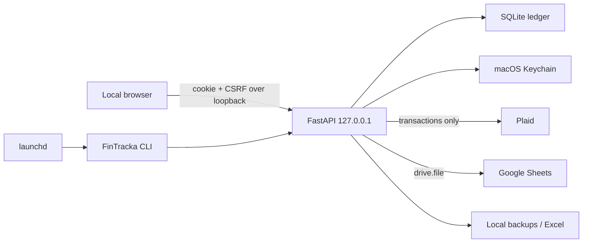

# FinTracka threat model

## Scope and assumptions

This model covers the localhost React/FastAPI application, SQLite ledger and backups, macOS Keychain, Plaid Production, Google Sheets, Excel exports, and launchd scheduling. It assumes one trusted macOS user, FileVault enabled, no LAN/public listener, and a public source repository containing no credentials. The approved testing exception is the lack of an off-device backup; hardware loss can therefore destroy all test data.

## System and trust boundaries

Trust changes at the browser/API boundary, every external provider, Keychain, and exported file. The most sensitive assets are provider/OAuth credentials, transaction and balance data, user edits, sync checkpoints, audit history, and backups.

## Attacker model

In scope: a hostile website targeting localhost, malicious provider/CSV text, stolen source or export files, interrupted/replayed provider calls, dependency compromise, and an attacker with access to the public repository. Malware already executing as the logged-in macOS user is a residual host-compromise risk; FinTracka cannot fully defend against it.

## Principal abuse paths

| Priority | Abuse path | Implemented control | Residual risk |
|---|---|---|---|
| High | Hostile page sends localhost requests or DNS-rebinding traffic | Loopback bind, Host/Origin checks, one-use fragment bootstrap, HttpOnly SameSite-Strict cookie, CSRF, no CORS, CSP and frame denial | A compromised local process can act as the user |
| High | Provider or Google token leaks to Git, SQLite, logs, UI, or browser storage | Keychain-only values, reference-only database rows, sanitized responses/logs, automated local leak scan; browser persists theme only | User can still disclose a secret outside the app |
| High | Retry/interruption advances a cursor without matching ledger data | Stable external IDs, complete pagination, `BEGIN IMMEDIATE`, checkpoint/data atomicity, tombstones, provider versions, audit events | Provider correctness remains an external dependency |
| High | Laptop theft exposes the ledger | FileVault live-data gate, `0700` directories, `0600` database/backups/exports | Logged-in malware and unlocked-device theft remain risks |
| High | Local disk failure destroys data | Verified pre-link SQLite backup and 30-day retention | Accepted testing risk: no off-device recovery |
| Medium | CSV/provider text executes in UI or spreadsheet | Strict schemas and size limits, React escaping, formula-prefix escaping, no raw HTML rendering | Export recipients can change sharing permissions |
| Medium | Third-party JavaScript compromise | Exact Plaid script/frame/connect CSP allowlist, no other runtime CDN, pinned lockfile and audits | Plaid's required stable SDK URL cannot use a fixed SRI hash |
| Medium | Over-broad Google access discloses Drive files | Desktop OAuth with `drive.file`; app creates its workbook and never auto-shares | Google account/share configuration is user-controlled |

## Security requirements and evidence

- `src/fintracka/api.py`: centralized local-session, Host, Origin, CSRF, CSP, framing, permissions, and cache controls; OpenAPI is disabled.
- `src/fintracka/plaid_service.py` and `src/fintracka/keychain.py`: production configuration, token cleanup, revocation, and Keychain-only secret values.
- `src/fintracka/sync.py`: idempotent provider application and atomic checkpointing.
- `src/fintracka/backups.py`: online backup, integrity verification, atomic replacement, restrictive permissions, and retention.
- `src/fintracka/google_sheets.py` and `src/fintracka/exports.py`: narrow OAuth scope, deterministic replacement, formula escaping, and atomic Excel output.
- `tests/test_api.py`, `tests/test_plaid_service.py`, `tests/test_readiness.py`, and browser tests exercise the high-risk boundaries.

## Required operating procedure

Run `scripts/verify.sh` and `scripts/scan_local_secrets.py` before every public push. Connect one institution, verify balances and imported accounts, reconcile a statement to zero, and observe it for seven days before expanding scope. Revoke the Plaid Item before deleting its Keychain token; preserve imported financial history unless permanent deletion is separately confirmed.
