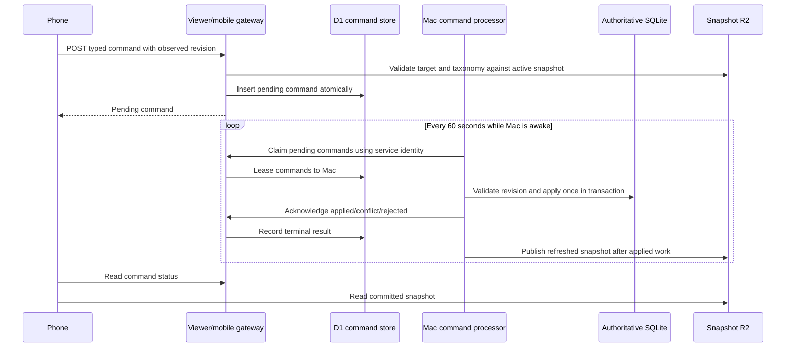

# Mobile Transaction Classification Editing Design

**Date:** October 30, 2026  
**Status:** Proposed for approval  
**Roadmap item:** 1 — Mobile transaction category and subcategory editing  
**Architecture guardrails:** [`ARCHITECTURE_GUARDRAILS.md`](../../../ARCHITECTURE_GUARDRAILS.md)

## Intent

Allow David and Ariela to correct the category and optional subcategory of any household transaction from the authenticated phone experience, including while the Mac is off. A phone edit is a proposed financial command until the Mac validates and commits it. The interface must distinguish proposed, applied, conflicted, cancelled, expired, and rejected states from the last published financial snapshot.

This feature also establishes the narrow command infrastructure later reused by approved Savings, Planning, and planned-income mobile edits. It is not a generic remote database or administration API.

## Confirmed product decisions

- Both David and Ariela may edit any household transaction, regardless of David/Ariela/Shared spending attribution.
- The Mac checks for commands once per minute while awake, even when the desktop window is closed.
- The phone flow is Edit → category → optional subcategory → explicit Save.
- Transactions may display a clearly labeled proposed overlay; Planning, Savings, and Reports remain committed-only until the Mac applies the command.
- An existing pending edit must be shown and explicitly replaced; it is never silently overwritten.
- Mac-side revision conflicts require review and show current versus proposed classification.
- Pending bank transactions may be edited and resolve through the canonical pending-to-posted alias when safe.
- A pending command may be cancelled until processing begins and expires after 30 days.
- Terminal command state remains in the cloud for 90 days; the Mac audit receipt remains permanent.
- Active built-in and custom categories/subcategories are selectable. Category is required except for the intentional Uncategorized choice; subcategory is optional.
- Initial editing is available only from mobile Transactions and its detail drawer.
- Initial notifications are in-app only.
- Command storage excludes merchant, amount, bank description, account details, and provider identifiers.
- D1 is used only within the free tier, with synthetic/staging proof before live household rollout.
- David and Ariela map to their confirmed Cloudflare Access identities. Production email values are provisioned into D1 through the secure Mac-only setup and are never committed to source, fixtures, screenshots, or logs.

## Goals

1. Accept a one-transaction classification proposal while the Mac is offline.
2. Authenticate and authorize the household member on the server.
3. Validate target, taxonomy, payload, size, and current published revision before queueing.
4. Apply each accepted command at most once to canonical SQLite state.
5. Detect local changes, replacements, pending-to-posted ambiguity, and invalid taxonomy without silent overwrite.
6. Publish the applied result back to the phone and retain a permanent local audit trail.
7. Remain inside Cloudflare's free D1 usage limits and add no paid service.

## Non-goals

- Mobile transaction archive/delete, manual-cash creation, split editing, merchant editing, notes, owner editing, or transfer decisions.
- Creating or changing categorization/subcategory rules from a phone command.
- Historic/future bulk categorization scopes; every mobile command is one-time.
- Mobile category or subcategory creation.
- Direct browser access to SQLite, Plaid, provider tokens, checkpoints, or local administrative APIs.
- Push/email notifications.
- Independent bank synchronization while the Mac is off.
- Turning D1 or the snapshot into an authoritative financial ledger or backup.

## Approaches considered

### 1. Existing Viewer Worker becomes a partitioned mobile gateway — selected

The existing Access-protected Worker continues serving static assets and read-only snapshot routes, and gains separately implemented D1-backed command routes. This keeps one phone origin and one login, avoids CORS, and lets the current application display snapshot and command states together. The Publisher Worker remains separate and write-only for snapshots.

### 2. Separate Commands Worker — not selected

This provides stronger infrastructure separation but requires another hostname/application, CORS policy, service-token policy, and potentially a second user authentication flow. It does not materially improve ledger safety because the queue still cannot write to SQLite.

### 3. Durable Object or R2 command queue — rejected

A Durable Object adds coordination complexity that household traffic does not require. R2 does not provide the transactional state changes required for replacement, claiming, cancellation, and exact-once acknowledgement.

## Existing foundations retained

- Remote snapshots are immutable and activated in increasing source-sequence order.
- Remote transactions already expose stable canonical IDs. The current general `updated_at` value is too broad for safe mobile classification conflicts because an unrelated provider update may change it, so this design adds a classification-specific revision.
- Pending-to-posted provider aliases preserve canonical transaction identity where resolvable.
- Local mutations already use SQLite transactions, optimistic revision checks, audit rows, and a global process lock.
- The Savings ledger, Planning effective versions, and bank checkpoints remain unchanged.
- Cloudflare Access continues protecting the phone origin.

## Authority and data flow



The phone may overlay a pending classification only in Transactions. All financial aggregates continue to come from the active snapshot.

## Cloudflare Access and member identity

### Browser identity

- User command routes remain behind the existing email-authenticated Access application.
- The Worker resolves the Access-authenticated email server-side and looks up one active D1 member.
- The Worker never accepts actor/member identity from request JSON.
- Email comparison is normalized and case-insensitive. Responses expose stable member ID and display name, not email.
- Unknown, inactive, missing, or ambiguous identities receive `403 MEMBER_NOT_AUTHORIZED`.

The Worker may use the Access runtime identity when available. Because Workers Static Assets can sit behind an internal router, the implementation must also support the Cloudflare-provided authenticated-email header on API routes. Staging security tests must prove an unauthenticated or spoofed direct request cannot reach a command route.

### Mac identity

- Create a dedicated Cloudflare Access service token for the Mac command processor and store its client ID/secret in macOS Keychain.
- Protect `/api/v1/mobile/mac/*` with a more-specific Access application/policy that permits only that service identity. The existing household email policy must not authorize these paths.
- The Mac endpoint never accepts a user email or browser session as processor authority.
- Publisher credentials and command-processor credentials remain separate.

### Provisioning

Production member emails are provisioned through a Mac-only administrative CLI call protected by the command service identity. Source migrations and test fixtures use synthetic addresses only. Provisioning is idempotent and records a safe audit row in D1.

## D1 schema

Migrations live under `remote/migrations/` and are applied separately to staging and production.

### `households`

- `id` text primary key
- `name` text
- `active` integer boolean
- `created_at`, `updated_at` UTC timestamps

Only one household is initially provisioned, but the household key remains explicit in every command.

### `household_members`

- `id` text primary key
- `household_id` foreign key
- `normalized_email` text unique within household
- `display_name` text
- `role` constrained to `member` initially
- `active` integer boolean
- `created_at`, `updated_at`

### `mobile_commands`

- `id` text primary key
- `household_id` and `actor_member_id` foreign keys
- `command_type` text: initially `transaction.set_classification`
- `command_version` integer: initially `1`
- `target_type` text: initially `transaction`
- `target_id` text
- `observed_revision` integer classification revision
- `payload_json` canonical JSON containing only nullable `category_id` and `subcategory_id`
- `payload_digest` text
- `idempotency_key` text, unique per actor
- `status`: `pending`, `processing`, `applied`, `conflict`, `rejected`, `cancelled`, `expired`, or `superseded`
- `supersedes_command_id` nullable self-reference
- `processor_id`, `claim_token`, `claimed_at`, `lease_expires_at`
- `result_json` nullable minimal IDs/revision only
- `error_code` nullable safe code
- `created_at`, `updated_at`, `expires_at`, `finished_at`

Indexes cover `(household_id, status, created_at)`, `(target_type, target_id, status)`, expiry, and terminal cleanup. A partial unique index allows at most one pending/processing command per target. Payload and result fields have strict size limits.

### `command_events`

- `id` text primary key
- `command_id` foreign key
- `actor_type`: `member`, `processor`, or `system`
- `actor_id` text
- `event_type`
- `safe_detail_json` nullable, excluding financial descriptions and amounts
- `occurred_at`

Events record creation, replacement, cancellation, claim, lease expiry, terminal acknowledgement, and expiry. Terminal commands and cloud events are deleted after 90 days.

## Snapshot contract version 2

The active snapshot must provide enough information for the phone and gateway to validate a proposal without duplicating financial state into D1.

Version 2 adds:

- `capabilities`, including supported command name/version pairs;
- `taxonomy`, containing active category IDs/names/types/groups and active subcategory IDs/names/parent category IDs;
- the existing transaction ID, category IDs, subcategory IDs, and pending flag;
- `classification_revision`, an integer changed only when the transaction's category/subcategory classification changes.

The strict TypeScript contract becomes a versioned union. The gateway and frontend first deploy with support for snapshots v1 and v2. Editing stays hidden for v1 or when the capability is absent. Only then does the Mac publisher begin producing v2. This preserves rolling compatibility and provides a future capability handshake.

Archived taxonomy is not selectable. If a transaction references an archived value, the drawer may display it, but the user must choose an active replacement or Uncategorized.

## Phone API

All browser mutations require same-origin JSON, an allowed `Origin`, an authenticated Access identity, bounded payload size, and no permissive CORS response.

### `GET /api/v1/mobile/session`

Returns the authenticated member's stable ID/display name, supported gateway capabilities, and server time. It contains no email.

### `GET /api/v1/mobile/commands`

Returns the member-visible command status needed for pending badges and the selected transaction. Both members can see household transaction-classification commands so competing changes are visible. It never joins merchant, amount, or account data into D1 results.

### `POST /api/v1/mobile/commands`

Accepts:

```json
{
  "command_type": "transaction.set_classification",
  "command_version": 1,
  "target_id": "canonical-transaction-id",
  "observed_revision": 3,
  "category_id": "active-category-id-or-null",
  "subcategory_id": "active-subcategory-id-or-null",
  "idempotency_key": "client-generated-random-value",
  "replace_command_id": null
}
```

The gateway reads the active snapshot and verifies that:

- the capability is supported;
- the target exists and the observed classification revision matches the displayed snapshot;
- the category is active or intentionally null;
- a non-null subcategory is active and belongs to the selected category;
- the payload contains no additional fields;
- the household has not exceeded conservative pending/rate limits.

If an active command exists, the response is `409 ACTIVE_COMMAND_EXISTS` with its safe status. Providing its ID as `replace_command_id` atomically supersedes the pending command and inserts the replacement. A processing command cannot be replaced.

Retries with the same idempotency key and identical digest return the original command. Reusing the key for different content returns `409 IDEMPOTENCY_CONFLICT`.

### `POST /api/v1/mobile/commands/{id}/cancel`

Cancels a household command only while it is pending. Processing or terminal commands cannot be cancelled. Cancellation is atomic with an event.

## Mac processor API

These routes are available only through the Mac service-identity Access policy.

### `POST /api/v1/mobile/mac/commands/claim`

Atomically expires overdue commands, releases expired leases, and leases up to a small bounded batch of oldest pending commands. A claim includes a random claim token and short lease. The endpoint returns only the command fields required for validation and application.

### `POST /api/v1/mobile/mac/commands/{id}/complete`

Requires the current claim token and accepts one terminal result: applied, conflict, or rejected. A repeated identical completion is idempotent. A stale claim token cannot change state.

### Member provisioning routes

Mac-only routes create/update/deactivate the two member mappings. They are separate from command processing, bounded to known roles, and never exposed in the phone UI.

## Mobile interface

### Transaction list

- A pending icon/label appears on a transaction with an active command.
- The list may display the proposed category/subcategory beside a clear `Pending` label.
- Amount, account, ownership, reports, and totals continue using committed snapshot values.

### Transaction drawer

- Shows committed classification and any pending proposal as separate rows.
- Edit opens a searchable category picker followed by an optional subcategory picker filtered to the chosen parent.
- Selecting Uncategorized clears both IDs.
- Save previews committed → proposed values and submits once.
- Existing pending work offers Replace or Cancel. Processing work is read-only until completion.
- Status language: Pending, Applying, Applied, Needs review, Rejected, Cancelled, Expired, or Replaced.
- Applied state remains visible until a snapshot at or after the application has refreshed the committed transaction.

### Conflict view

Needs review displays current committed category/subcategory from the newest snapshot and the proposal. Resubmitting creates a new command with the newest revision; it never forces the stale command through.

## Mac-side command processor

### Scheduling

- Add `com.fintracka.mobile-commands` as a separate user LaunchAgent with `RunAtLoad` and `StartInterval=60`.
- The process runs while the user session and Keychain are available, even if no FinTracka browser window is open.
- The CLI entry point is `fintracka remote commands process`.
- It uses the existing global financial process lock. If another sync/write holds the lock, it exits cleanly and retries next minute.
- Startup and successful bank sync may request an immediate processing pass, but the minute schedule remains the recovery path.

### Local receipt table

A new SQLite migration adds `mobile_command_receipts`:

- `command_id` primary key
- `command_type`, `command_version`, `payload_digest`
- `actor_member_id`
- `status` and safe result/error code
- `applied_revision` nullable integer classification revision
- `processed_at`
- `snapshot_published_at` nullable

The receipt is inserted in the same SQLite transaction as an applied classification and its audit event. It is never deleted by cloud retention. If a lease retries after local commit but before cloud acknowledgement, the receipt prevents reapplication and lets the Mac resend the prior result.

### Applying `transaction.set_classification/v1`

Create one domain service for an atomic, one-time classification assignment:

1. Resolve the canonical transaction or safe pending-to-posted alias.
2. Verify the current `classification_revision` equals `observed_revision`; otherwise return conflict with current IDs/revision.
3. Verify target is not tombstoned/archived and category/subcategory remain valid.
4. Set category and subcategory together, clear subcategory when Uncategorized, set manual provenance, increment `classification_revision`, and update the general transaction timestamp.
5. Do not create or modify a categorization rule.
6. Run the same Savings reconciliation hooks used by local classification changes.
7. Record before/after audit data with stable mobile member ID and command ID.
8. Insert the permanent command receipt and commit.

`classification_revision` is added by migration with a zero default and is incremented by every local category or subcategory mutation path, including rules and desktop edits. Provider-only changes such as pending-to-posted status do not increment it. This lets a safe pending-to-posted transition preserve a phone proposal while a competing classification change produces a real conflict.

Validation/business logic lives below the HTTP route so desktop and mobile processors cannot diverge.

### Publication after application

After processing a batch, publish one refreshed snapshot if at least one command applied. If publication fails after SQLite commit, the local receipt remains marked as awaiting publication. The next minute retries publication without reapplying the command. The phone may show `Applied; refreshing financial data` during this interval.

## Replacement, cancellation, and races

- Pending replacement is one D1 transaction: verify active command, mark it superseded, insert the new command, and add events.
- Cancellation uses a status predicate so it cannot win after a claim begins.
- Claiming uses a status predicate and lease token so two processor attempts cannot own the same command simultaneously.
- A lease expiration returns an unacknowledged processing command to pending.
- A Mac crash before SQLite commit leaves no local receipt and the command safely retries.
- A Mac crash after commit but before completion acknowledgement finds the receipt and acknowledges without mutation.
- Two phone saves with the same idempotency key cannot create two commands.
- A local desktop edit after phone submission produces a conflict rather than an overwrite.

## Security and privacy

- Default deny every unknown route, method, command type, version, member, category, and state transition.
- Enforce Access on both user and Mac paths; staging tests must cover unauthenticated, wrong-email, inactive-member, email-session-on-Mac-path, and service-token-on-user-path cases.
- Validate `Origin`, JSON content type, Fetch Metadata where present, body size, string lengths, UUID/ID shapes, and exact payload fields.
- Apply conservative per-member creation limits and a household pending-command cap without adding a paid rate-limiting product.
- Use prepared D1 statements and canonical JSON digests.
- Return safe stable error codes; never log secrets or command payloads.
- Store no merchant, description, amount, account, institution, provider ID, or token in D1 commands/events.
- Keep production emails and service credentials out of source, tests, screenshots, and CI logs.
- Preserve existing CSP, no-store, frame, referrer, and content-type security headers.

## Cost boundary

As checked on October 30, 2026, the Workers Free D1 allowance includes 5 million rows read per day, 100,000 rows written per day, and 5 GB total storage. One empty poll per minute plus household command traffic is far below those limits. Indexed lookups, bounded list results, 90-day retention, and no financial-data duplication keep usage predictable.

If current free limits or Access behavior differ at rollout time, implementation pauses before enabling production. No paid Cloudflare plan or add-on is authorized by this design.

References:

- [Cloudflare D1 pricing](https://developers.cloudflare.com/d1/platform/pricing/)
- [Cloudflare Access identity in Workers](https://developers.cloudflare.com/workers/configuration/cloudflare-access/)
- [Cloudflare D1 batch transaction behavior](https://developers.cloudflare.com/d1/worker-api/d1-database/)

## Testing

### TypeScript/Worker

- D1 migrations and constraints, member resolution, strict payload validation, taxonomy validation, idempotency, replacement, cancellation, expiry, lease recovery, terminal acknowledgement, retention, and safe error bodies.
- Synthetic Access identities and service authorization; no real household emails in fixtures.
- Snapshot v1/v2 rolling compatibility and capability hiding.

### Python/domain

- Atomic classification/category-parent validation, Uncategorized behavior, no rule creation, revision conflict, tombstoned transaction, pending-to-posted alias, permanent receipt, duplicate lease, audit actor/command linkage, Savings reconciliation, and publish-outbox recovery.

### Frontend

- Picker filtering/search, explicit Save, proposed-versus-committed labels, replacement confirmation, cancellation, processing lock, conflict/resubmit, expired/rejected states, accessibility, and no changes to Planning/Reports totals before application.

### End-to-end and fault injection

- Phone submits while Mac is off; Mac later applies exactly once and publishes.
- Crash before commit, after commit/before acknowledgement, after acknowledgement/before publish, and during publish retry.
- Two members compete on one transaction; replacement is explicit.
- Direct API attempts cannot archive, delete, create rules, choose an invalid subcategory, impersonate an actor, or call Mac routes.
- 30-day expiration and 90-day cleanup.
- Full workflow uses synthetic finance data through staging before production.

## Deployment and rollout order

1. Implement and test D1 migrations, gateway command modules, snapshot v2 compatibility, Mac processor, and UI against local/synthetic fixtures.
2. Create staging D1, apply migrations, deploy gateway support for snapshot v1/v2, and configure synthetic member/service identities.
3. Deploy Mac snapshot-v2 support only after the staging gateway accepts both versions.
4. Run authorization, conflict, exact-once, interruption, retention, and free-usage checks in staging.
5. Create production D1 and apply migrations.
6. Configure the two production member mappings without committing their emails.
7. Create the dedicated Mac service token and the more-specific Mac-path Access policy; store credentials only in Keychain.
8. Deploy the production gateway with command creation disabled by a capability flag.
9. Install the one-minute Mac processor and verify claim/application/publication using a harmless synthetic or designated test record.
10. Enable the transaction-classification capability for household users.
11. Monitor errors, D1 usage, pending age, publication freshness, and audit receipts; retain an immediate feature-disable switch that does not affect read-only viewing.

## Acceptance criteria

- Either household member can submit a valid classification while the Mac is off and see Pending without changing financial totals.
- Within about one minute of the Mac being awake, a non-conflicting command is applied exactly once, audited, acknowledged, and republished.
- A stale local revision, ambiguous pending-to-posted identity, invalid taxonomy, unauthorized actor, duplicate, replacement race, or interrupted processor never silently overwrites or double-applies.
- A direct mobile request cannot archive/delete a transaction, create a rule, access Plaid, or invoke Mac processor endpoints.
- Production command storage contains no merchant, amount, bank description, account, or provider identifiers.
- The feature remains within the free Cloudflare tier and can be disabled without affecting the existing private read-only viewer.
